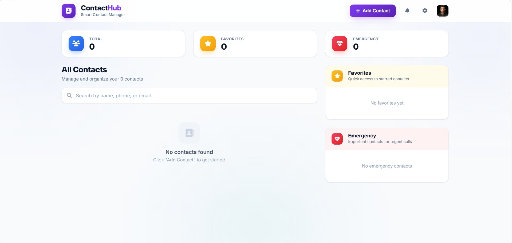
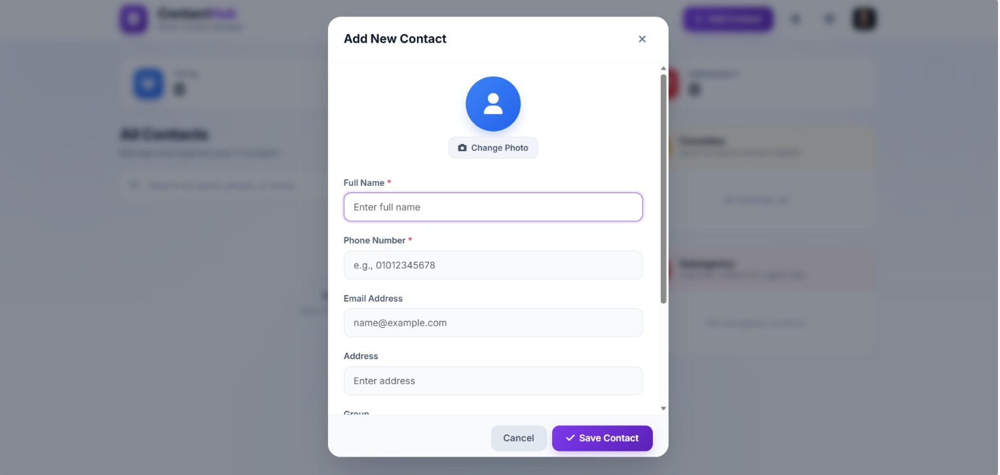
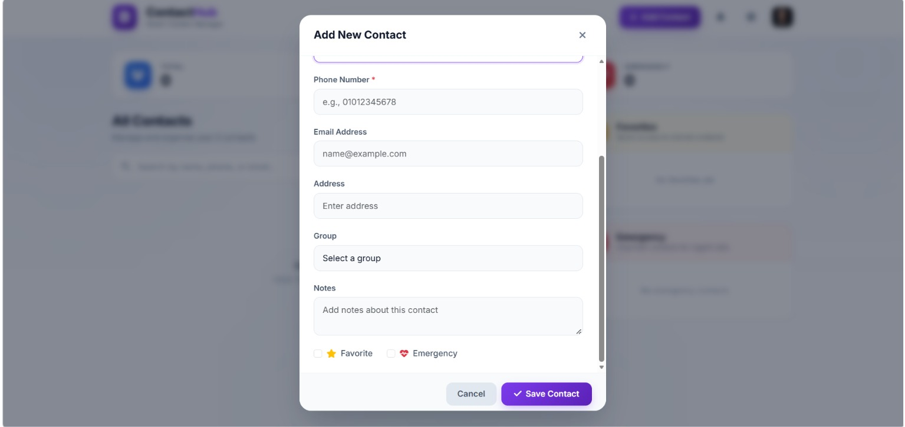

# 📱 ContactHub | Smart Contact Manager

A responsive contact management web application built with HTML, CSS, and JavaScript.

ContactHub helps users organize and manage their contacts through a clean, modern, and interactive interface.

## 🌐 Live Demo

[View Live Website](https://sandy-mohamed.github.io/ContactHub-Contact-Manager/)

## 📸 Screenshots

### Contact Dashboard


### Add New Contact


### Contact Details


## ✨ Features

- Add and manage contacts
- Search contacts by name, phone number, or email
- Contact dashboard with total, favorites, and emergency counters
- Browser-based contact data persistence
- Modern and responsive user interface

## 🛠️ Technologies Used

- HTML5
- CSS3
- JavaScript
- Browser Local Storage

## 📁 Project Structure

```text
ContactHub/
├── index.html
├── css/
│   └── style.css
├── js/
│   └── main.js
└── images/
    └── avatar-4.jpg
```

## 🚀 Getting Started

1. Clone or download the repository.
2. Open `index.html` in your browser.
3. Start managing your contacts.

## 👩‍💻 Developer

**Sandy Mohamed**

Front-End Developer

[GitHub Profile](https://github.com/sandy-mohamed)
